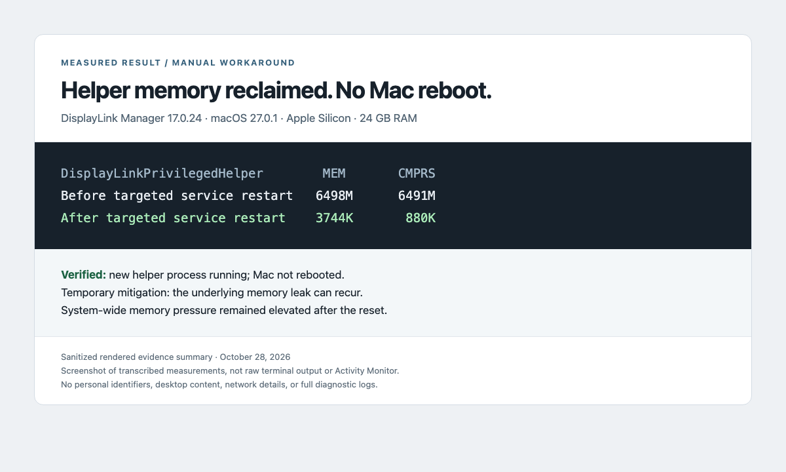

# DisplayLink memory workaround for macOS

Recover memory held by `DisplayLinkPrivilegedHelper` **without rebooting your Mac**.
A small, dependency-free diagnostic and manual service reset. Unofficial; not affiliated with Synaptics, DisplayLink, or Apple.

> **Workaround, not a driver fix.** Restarting the helper clears its accumulated memory. It does not repair the underlying leak, and memory can grow again. External displays may briefly blink.



*Screenshot of a locally rendered evidence summary, transcribed from real measurements. It is not an Activity Monitor screenshot or raw terminal capture. Only allowlisted technical values are shown.*

## When this helps

The investigated configuration was **DisplayLink Manager 17.0.24 on macOS 27.0.1**, Apple Silicon, 24 GB RAM. The helper had accumulated approximately 6.5 GB after 26 days. A targeted helper restart reduced the measured process memory to approximately 3.7 MB; the machine was not rebooted.

DisplayLink support [acknowledged a matching memory-growth issue on October 2, 2026](https://www.displaylink.org/forum/showthread.php?p=99661). That acknowledgement establishes a known issue; it does not prove that every slowdown has this cause.

**Scope:** manually verified service reset on the configuration above. Other versions and hardware are unverified. A large memory footprint alone does not prove a leak, and allocated swap alone does not prove current disk thrashing. The overall system still reported elevated memory pressure after the reset; this is not a claim that every performance problem was solved.

## Use

Download or clone this repository, inspect the script, then open Terminal in its directory. Requires macOS, Bash and Apple's built-in command-line tools; an admin account is needed only for reset. Do not run the entire script with `sudo`.

```bash
# Read-only. No administrator privileges required.
bash scripts/displaylink-memory.sh diagnose

# Explicit confirmation followed by the normal sudo password prompt.
bash scripts/displaylink-memory.sh reset

# Verify again after the service has started.
bash scripts/displaylink-memory.sh diagnose
```

The reset requires you to type `RESET`. Enter your password only at the local macOS `sudo` prompt; password characters are not displayed. Cancelling before authorization leaves the service unchanged.

The sole privileged operation is this fixed command:

```bash
sudo /bin/launchctl kickstart -k system/com.displaylink.DisplayLinkManager.PrivilegedHelper
```

The script does not install a daemon, schedule resets, stop Docker, change VPN settings, delete data, disable macOS protections, or contact a server. It accepts no service names, PIDs, shell commands, or arbitrary paths as input. No installation or uninstall step is needed; delete the downloaded directory when finished.

## Verify the result

Compare the helper's `MEM` column before and after reset. `CMPRS` is compressed process memory as reported by `top`; do not add it to `MEM` as if it were an independent allocation. A new helper PID is expected. Units below are preserved exactly as `top` printed them.

| Measurement | Before | After |
| --- | ---: | ---: |
| Helper `MEM` | `6498M` | `3744K` |
| Helper `CMPRS` | `6491M` | `880K` |
| Mac reboot | — | No |
| Helper running | Yes | Yes |

See [evidence and limitations](docs/EVIDENCE.md), [troubleshooting](docs/TROUBLESHOOTING.md), and the [scoped security review](docs/SECURITY-REVIEW.md).

## Durable resolution and reporting

Check the [official download page](https://www.synaptics.com/products/displaylink-graphics/downloads/macos) and release notes for a manufacturer fix. As checked on **October 28, 2026**, the official appcast still listed **17.0.24**. This is a dated observation, not an automatic update checker. Prefer a verified manufacturer fix when available.

The sanitized observation is published in [GitHub tracking issue #1](https://github.com/eShok93/displaylink-memory-workaround/issues/1), including the measured result, screenshot, workaround and unresolved questions. This independent issue is not the manufacturer's official bug tracker. The [manufacturer report draft](docs/UPSTREAM-REPORT.md) remains available as a reference; no forum post has been submitted.

GitHub issues in this repository are for this workaround and its documentation. We cannot patch the unavailable helper source. Do not open this macOS bug against DisplayLink's unrelated Linux EVDI project.

## Privacy and security

`diagnose` prints only the macOS version, DisplayLink version, helper PID, and that helper's memory row. It suppresses `top`'s machine-wide summary. A PID is a temporary local process identifier. The script does not save or transmit the result. Review even this narrow output before posting it.

**Do not upload full diagnostic archives, crash reports, desktop screenshots, network configuration, tokens, usernames or serial numbers to public issues.** Manufacturer support bundles can contain substantially more data than this tool; review them and use the manufacturer's private support channel where appropriate.

See [SECURITY.md](SECURITY.md) for the trust boundary and disclosure policy. Licensed under [MIT](LICENSE); no vendor binaries are redistributed.
